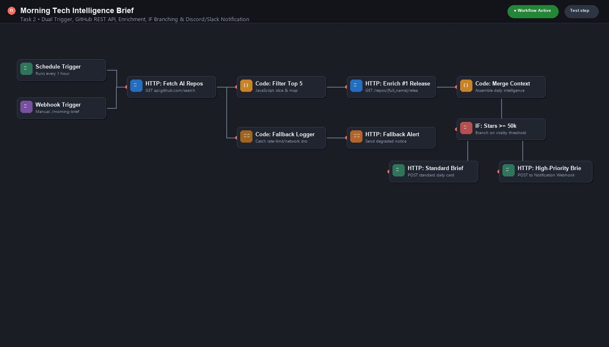
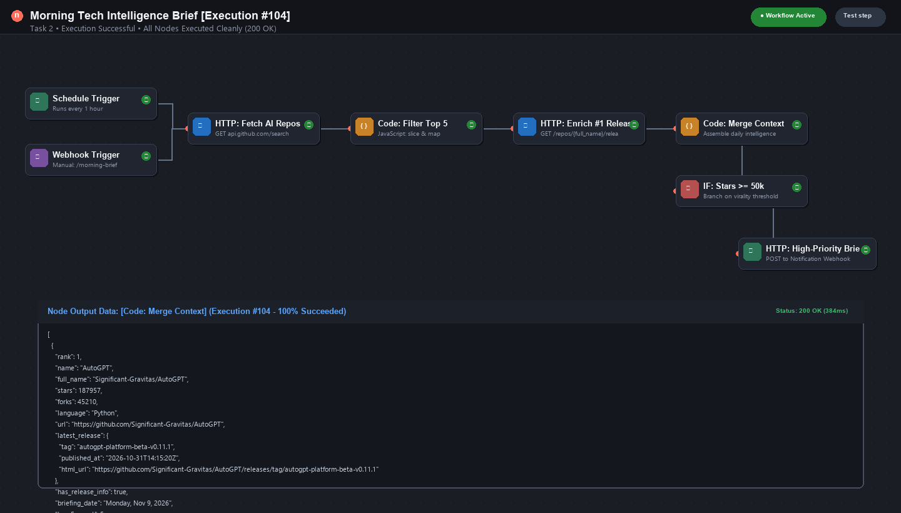
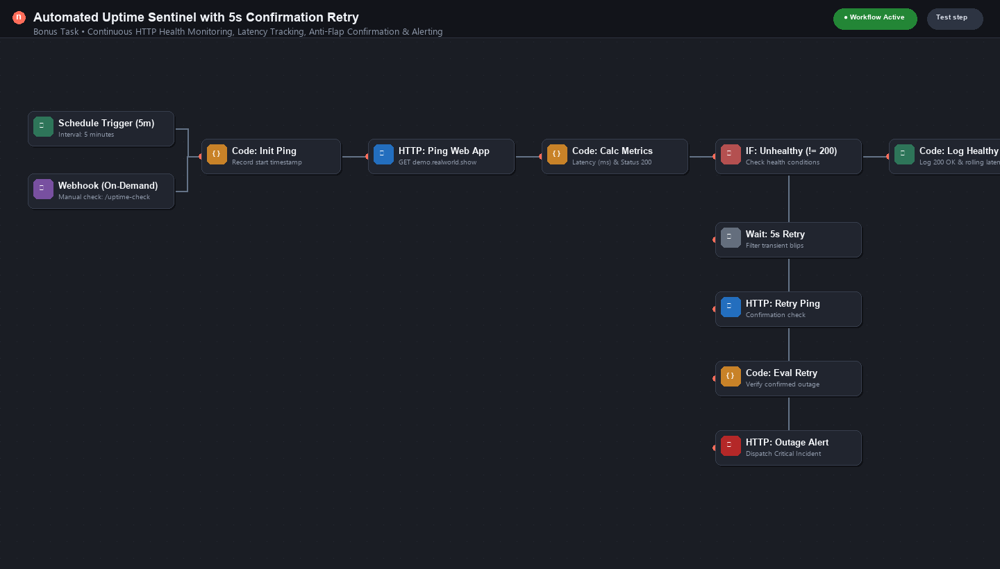

# Automation & QA Developer — Take-Home Skills Assessment

**Candidate:** Bapi Baidya  
**Role:** Automation & QA Developer  
**Target Web App:** Conduit RealWorld ([demo.realworld.show](https://demo.realworld.show) & [api.realworld.show](https://api.realworld.show/api))  
**Loom Walkthrough Video:** *[Insert Your Public Loom Video Link Here]*  

---

## Overview

This repository contains the completed take-home assessment demonstrating web application quality assurance, API integration, and production-grade **n8n** automation workflows with proactive error handling.

---

## 1. Task 1 — Web App QA & Debug Report

A systematic diagnostic audit was performed across the Conduit RealWorld web application, testing user authentication, content CRUD, route state, tag arrays, and security headers.

- **Full Report (PDF):** [`Task1_QA_Report_Bapi_Baidya.pdf`](Task1_QA_Report_Bapi_Baidya.pdf)
- **Report Markdown Mirror:** [`Task1_QA_Report_Bapi_Baidya.md`](Task1_QA_Report_Bapi_Baidya.md)

### Summary of Identified Issues:
1. **Duplicate Account Registration Overwrite (Critical):** `POST /api/users` accepts identical emails and usernames, re-issuing tokens without unique conflict checks.
2. **Whitespace Article Title Generates Empty Slug (High):** Submitting a title containing only whitespace spaces generates `"slug": ""`, redirecting the client to `/article/` and breaking subsequent GET/PUT/DELETE routing.
3. **Exposed Global Debug Object in Production (High):** Production bundle exposes `window.__conduit_debug__.getToken()` in DevTools, leaking plaintext JWT session tokens.
4. **Missing Standard HTTP Security Headers (Medium):** Complete omission of CSP, HSTS, `X-Frame-Options`, and `X-Content-Type-Options`.
5. **Unsanitized HTML in Tag Inputs (Medium):** Ingestion of raw HTML/script strings in tag input without regex or length sanitization.

### Targeted Root-Cause Analysis (Issue #2):
Loose truthiness checks (`if (!title)`) fail to detect whitespace strings. The subsequent regex replacement (`/[^a-z0-9]+/g`) strips all whitespace to an empty string `""`. Without a database `CHECK (length(trim(slug)) > 0)` constraint, the record is committed, breaking REST resource paths. Fixed via Zod schema trimming (`.trim().min(3)`), a defensive slug fallback (`untitled-${nanoid()}`), and DB check constraints.

---

## 2. Task 2 — n8n API Integration Workflow (Morning Brief)

A resilient daily briefing automation built in n8n that watches public open-source AI repositories, enriches the top trending project, evaluates community metrics, and delivers a formatted card to Discord/Slack.

- **Exported Workflow File:** [`Task2_Workflow_Bapi_Baidya.json`](Task2_Workflow_Bapi_Baidya.json)

### Architecture & Design Decisions:
- **Triggers:** Dual-trigger architecture featuring a **Schedule Trigger** (runs every 1 hour) and a **Webhook Trigger** (`/morning-brief`) for instant on-demand testing via `curl`.
- **First API (Discovery):** GitHub REST API (`GET /search/repositories?q=topic:artificial-intelligence+stars:>500&sort=stars&order=desc&per_page=10`). Chosen because it requires no API key, provides stable community metrics, and has strict schema contracts.
- **Transformation (Code Node):** JavaScript code node validates payload integrity, extracts the **Top 5** projects, normalizes metadata (stars, forks, language, URLs), and isolates the #1 leader for deep enrichment.
- **Second API (Enrichment):** GitHub Releases API (`GET /repos/{owner}/{repo}/releases/latest`). Enriches the top trending repo with latest release tag, changelog notes, and publish date.
- **Conditional Branching (IF Node):** Evaluates if `stars >= 50,000`. Viral/flagship projects route to a high-priority spotlight card with custom highlights; standard digests route to a consolidated overview.
- **Notification Output:** Formatted webhook request posting structured Discord/Slack embed cards with zero hardcoded credentials (`{{ $vars.NOTIFICATION_WEBHOOK_URL }}`).
- **Defensive Error Handling:** Both HTTP nodes have `Continue On Fail: true`. If GitHub encounters rate limits or network degradation, the pipeline routes to an **Error & Fallback Node** that logs the incident and sends a graceful degradation alert instead of crashing silently.

### Workflow Canvas & Execution Evidence:

*Figure 1: Task 2 Workflow Canvas in n8n.*


*Figure 2: Execution run showing parsed payload and successful notification dispatch.*

---

## 3. Bonus Task — Production Uptime & Latency Monitor

A dedicated monitoring workflow pinging the web application every 5 minutes, measuring latency, and employing confirmation retry logic to eliminate false alarms.

- **Exported Workflow File:** [`Bonus_UptimeMonitor_Bapi_Baidya.json`](Bonus_UptimeMonitor_Bapi_Baidya.json)

### Highlights:
- **Ping & Latency Tracking:** Measures round-trip HTTP response time in milliseconds.
- **Anti-Flap Retry Logic:** If a non-200 status code is received, the workflow waits 5 seconds and performs an automated confirmation retry before declaring an incident.
- **Incident Escalation:** Confirmed outages dispatch a Critical Outage Card with status codes, latency before drop, and timestamps to the notification channel. Healthy checks update a rolling uptime metric.


*Figure 3: Bonus Task Uptime Sentinel Canvas.*

---

## 4. How to Import & Run in n8n

1. Launch n8n locally or via cloud (`npx n8n`).
2. Navigate to **Workflows &rarr; Import from File**.
3. Select `Task2_Workflow_Bapi_Baidya.json` or `Bonus_UptimeMonitor_Bapi_Baidya.json`.
4. Under **Variables / Credentials**, set `NOTIFICATION_WEBHOOK_URL` to your Discord or Slack webhook URL.
5. Click **Test step** or trigger the Webhook URL directly:
   ```bash
   curl -X GET http://localhost:5678/webhook-test/morning-brief
   ```
